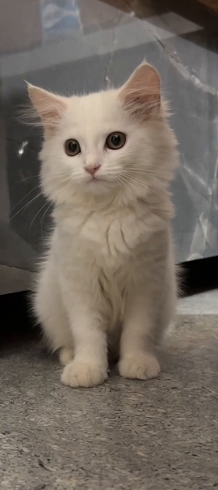
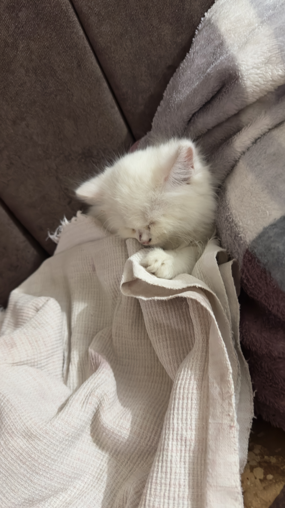

<h4 align="center">Hi there! 👋</h4>

💻 I love writing open-source code, and I’m the proud father of two kittens. 🐱🐱

<table align="center" width="100%">
  <tr>
    <td align="center" valign="top" width="50%">
      
       
      <strong>🐾 Migi</strong>
      

        
📖 Story behind her name

        

          
Adopting a kitten had been a dream of mine for a very long time, and I used to talk about it a lot with a friend of mine.

          
During one of those conversations, I promised her, “You choose the name, and whatever you pick, I’ll name my first kitten that.”

          
She chose <strong>Migi</strong>. 🐾

          
And when that dream finally came true, I kept my promise.

          
So Migi’s name will always be a little more special to me. Every time I call her, it quietly reminds me of the person who named her

        

      

    </td>
    <td align="center" valign="top" width="50%">
      
       
      <strong>🐾 Po</strong>
      

        
📖 Story behind her name

        

          
She is so fluffy and fat that she resembles Po from <em>Kung Fu Panda</em> 🐼, so I named her Po.

        

      

    </td>
  </tr>
</table>